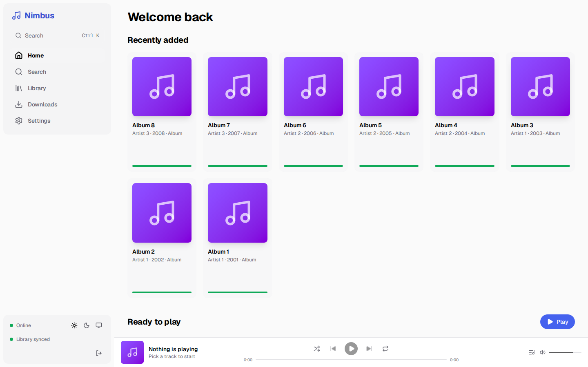
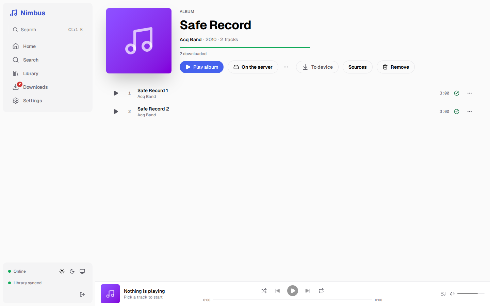
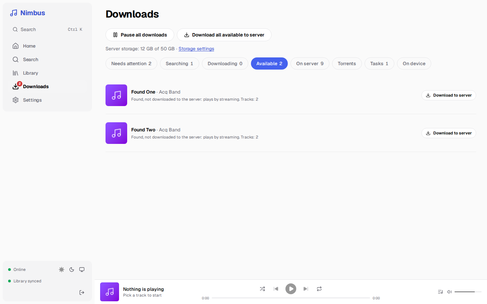
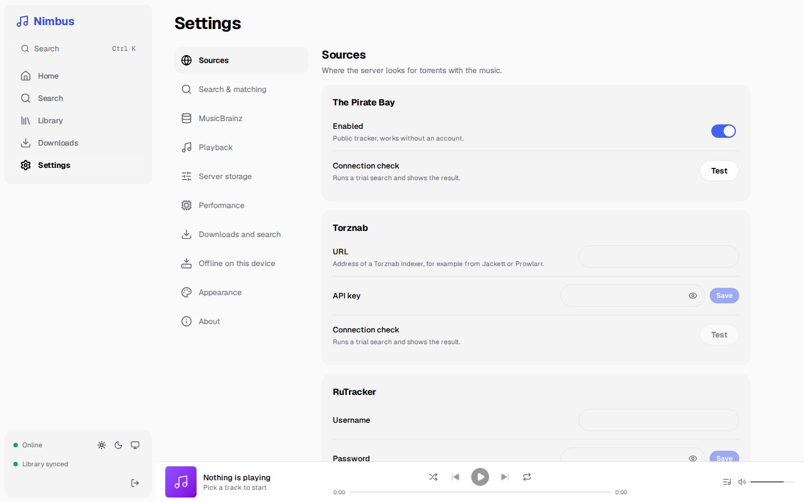

# Nimbus

A self-hosted web music player: metadata from [MusicBrainz](https://musicbrainz.org), music streamed straight from torrents.

- **Frontend:** React SPA (`client/`, Vite, bun) — an installable PWA; the backend serves the built files itself
- **Backend:** Rust — axum, sqlx, librqbit (`backend/`)
- **Database:** PostgreSQL

Two containers: `db` (PostgreSQL) and `nimbus` (backend + web client on one port, one origin).

> **Disclaimer.** This is a research / experimental project. Legally, it can only be used to listen to music that is
> in the public domain (or that you otherwise have the explicit right to download and share). Nimbus does not host or
> provide any content and does not verify the legal status of what you stream.

> **Legal notice.** Downloading and sharing copyrighted content may be illegal in your country. This project is
> intended for personal use with content you have the rights to. You are solely responsible for how you use it.

| Home | Album |
|---|---|
|  |  |
| **Downloads** | **Settings** |
|  |  |


## Features

- **Local-first app.** The whole library is synchronised to the browser (snapshot + deltas over WebSocket pokes) and kept
  in IndexedDB: screens switch instantly and open without waiting for the network.
- **Offline tracks.** Download tracks, albums or playlists to the device (OPFS file storage, limit and Wi-Fi-only options in
  *Settings → Offline*); they play without a connection.
- **Installable PWA** with lock-screen controls and background audio; works on phones, tablets and desktop.
- **Downloads screen:** what has not been found yet and why, automatic and manual search retry, server-side downloads.

- Search artists, albums and tracks via MusicBrainz (⌘K / Ctrl+K); cover art from the Cover Art Archive.
- Library: add an album or a whole discography — Nimbus finds releases on its own (TPB, Torznab/Jackett/Prowlarr,
  RuTracker), checks their contents and matches files to tracks.
- Streaming playback directly from the torrent (HTTP Range, seeking); ffmpeg transcoding for CUE images and APE/WV/DSD.
- Live track statuses over WebSocket: searching → playable → downloaded.
- Manual source selection, custom magnet links, search retry.
- Pinning: download an album or track to the server on demand (queue, concurrency limit, pause); pinned files are
  never evicted from the cache, so they count against — and may exceed — the cache limit. Optional auto-download
  of everything added to the library.
- Settings in the UI, cache size limit with eviction, next-track prefetch, optional seeding.
- Simple single-user token authentication.
- UI in 14 languages (English, Русский, Español, Français, Deutsch, 中文, Português, Italiano, 日本語, 한국어,
  Українська, Polski, Türkçe, हिन्दी); chosen by browser language by default.

## Quick start (Linux / macOS)

Requirements: [Docker](https://docs.docker.com/get-docker/) with the Compose v2 plugin (on macOS: Docker Desktop;
on Linux: Docker Engine, and your user in the `docker` group). Nothing else is needed: Rust and bun are only
used inside the build containers, never on your machine.

```sh
git clone https://github.com/axelrodvl/nimbus.git nimbus
cd nimbus
./start.sh           # pull the published images and start the stack
```

Then open **http://localhost:8000**.

### Scripts

There are two sets: the **root** scripts run the published builds (no source build, nothing but Docker needed),
the **`scripts/`** set builds and runs your local checkout (development).

| Script | What it does |
|---|---|
| `./start.sh [version]` | Pulls `ghcr.io/axelrodvl/nimbus` (+ Postgres) and starts the stack, waiting until both are healthy. The version is the argument (`./start.sh 0.3.0`), else `NIMBUS_VERSION` from `.env`, else `latest`. |
| `./stop.sh` | Stops and removes the containers. The database and `./data` are kept. `--purge` also deletes the database volume. |

Development (local images, `nimbus:local`):

| Script | What it does |
|---|---|
| `./scripts/build.sh` | Builds the single `nimbus:local` image (the Rust and bun/Vite builds run inside Docker) and pre-pulls Postgres. The first build takes several minutes; later builds reuse the BuildKit cache (cargo registry/`target`, bun cache). Arguments go to `docker compose build`, e.g. `--no-cache`. |
| `./scripts/start.sh` | Starts the stack (Postgres + Nimbus) from the built image and waits until both are healthy. Builds nothing; if the image is missing it asks you to run `build.sh`. |
| `./scripts/stop.sh` | Stops and removes the containers. Images, the database and `./data` are kept. `--purge` also deletes the database volume. |

`build.sh` and `start.sh` create `.env` from `.env.example` if it does not exist yet. Shortcuts if you have
[just](https://github.com/casey/just): `just build`, `just start`, `just stop`, `just up` (build + start).

To update the published build: `./stop.sh && ./start.sh` (pulls the new `latest`, or pass a version). To update a local build: `git pull`, `./scripts/stop.sh`, `./scripts/build.sh`, `./scripts/start.sh`. Both sets use one Compose project (`nimbus`) and the same database volume and ports, so run only one at a time. Data (database, `./data`)
is kept; the installed app in the browser updates itself (a banner offers the new version).

Upgrading from the old Next.js version (separate `web` and `caddy` containers): same steps; `stop.sh` removes the
leftover containers (`--remove-orphans`), and the old service worker is replaced by the new one on first load.

- Logs: `docker compose logs -f` (or `just logs`)
- Data (torrents, cache) lives in `./data`; the database lives in the `nimbus_pgdata` Docker volume.
- Port `6881` (TCP/UDP) is published for incoming BitTorrent connections. It is set by `NIMBUS_TORRENT_PORT`
  (default `6881`; docker compose publishes whatever port it is set to; a busy port falls back to a random one).

Before the first run you may want to edit `.env`:

| Variable | Purpose |
|---|---|
| `NIMBUS_API_TOKEN` | Enables authentication (strongly recommended if exposed beyond localhost) |
| `NIMBUS_MB_USER_AGENT` | Your contact, e.g. `Nimbus/1.0 ( you@example.org )` — see [MusicBrainz](#musicbrainz-and-user-agent) |
| `NIMBUS_PORT` | Public port (default `8000`) |
| `NIMBUS_CACHE_LIMIT_GB` | Torrent cache limit (default `50`) |

Changes to `.env` take effect after `./scripts/start.sh`; no rebuild is needed.

## Install on a phone and use offline

Open Nimbus in the phone's browser over HTTPS (see [Authentication](#authentication) for a reverse proxy) and install it:
**iOS Safari** — Share → *Add to Home Screen*; **Android Chrome** — menu → *Install app*. For offline tracks open
*Settings → Offline* and ask for persistent storage (iOS evicts unprotected site data after a week of inactivity);
then use the download button on a track, album or playlist. Tracks on the device play without a network, the library
stays readable, and changes sync as small deltas when the connection returns.
A manual device checklist is in [docs/device-checklist.md](docs/device-checklist.md).

## Run from prebuilt images (no build)

Each [GitHub Release](https://github.com/axelrodvl/nimbus/releases) ships a ready-to-run bundle that pulls
multi-arch (amd64/arm64) images from GHCR (`ghcr.io/axelrodvl/nimbus`):

```sh
unzip nimbus-vX.Y.Z.zip && cd nimbus
cp .env.example .env
docker compose up -d
```

To publish a release (version `X.Y.Z`):

1. Set the version in `backend/Cargo.toml` (`[workspace.package]`, then `cargo update --workspace --offline` to refresh `Cargo.lock`), `client/package.json` and `client/openapi.json` (`info.version`; `just openapi-check` verifies it matches the backend), add the entry to `CHANGELOG.md`, and write the English release notes in `docs/releases/vX.Y.Z.md` (copy `docs/releases/TEMPLATE.md`; `scripts/release-notes.sh --draft` lists the commits since the last tag). The release workflow fails if the file is missing or breaks the fixed section order. The version shows up in `/api/health` and in the UI.
2. Commit, then `git tag -a vX.Y.Z -m vX.Y.Z && git push origin main vX.Y.Z`. The workflow `.github/workflows/release.yml` builds the multi-arch image and creates the GitHub Release with the run bundle.

The images are public (`ghcr.io/axelrodvl/nimbus`, tags `X.Y.Z`, `X.Y`, `latest`, without the `v` prefix; linux/amd64 and linux/arm64). Run a specific one with `./start.sh X.Y.Z`.

## Windows (via WSL 2)

Nimbus is run on Windows inside **WSL 2** (Windows Subsystem for Linux) using Docker. Requires Windows 10 (22H2) or
Windows 11.

### 1. Enable virtualization in BIOS/UEFI

WSL 2 runs a lightweight virtual machine, so hardware virtualization must be on. Check first: open **Task Manager →
Performance → CPU** and look for *Virtualization: Enabled*. If it says *Disabled*:

1. Reboot and enter BIOS/UEFI (usually `Del`, `F2`, `F10` or `Esc` right after power-on).
2. Enable **Intel VT-x / Intel Virtualization Technology** (Intel) or **SVM Mode / AMD-V** (AMD). It is often under
   *Advanced → CPU Configuration*.
3. Save and reboot.

### 2. Install WSL 2 and Ubuntu

Open **PowerShell as Administrator**:

```powershell
wsl --install -d Ubuntu
```

Reboot when asked, then launch "Ubuntu" from the Start menu and create a Linux username and password.
Verify it is version 2: `wsl -l -v` (if not: `wsl --set-version Ubuntu 2`).
If the command fails, make sure the *Virtual Machine Platform* and *Windows Subsystem for Linux* features are enabled
(`optionalfeatures.exe`), then reboot.

### 3. Install Docker

Pick one:

- **Docker Desktop (easiest):** install [Docker Desktop for Windows](https://www.docker.com/products/docker-desktop/),
  then in *Settings → General* enable **Use the WSL 2 based engine** and in *Settings → Resources → WSL integration*
  enable your Ubuntu distro. (Review Docker Desktop's licensing terms for commercial use.)
- **Docker Engine inside Ubuntu (no Desktop):** in the Ubuntu terminal follow
  [Install Docker Engine on Ubuntu](https://docs.docker.com/engine/install/ubuntu/), then
  `sudo usermod -aG docker $USER`, restart the terminal, and `sudo service docker start`
  (or enable systemd in WSL: add `[boot]` / `systemd=true` to `/etc/wsl.conf` and run `wsl --shutdown`).

### 4. Run Nimbus

**Inside the Ubuntu terminal** (not PowerShell), and keep the project in the Linux filesystem (`~`), not under
`/mnt/c` — it is much faster:

```sh
cd ~
git clone https://github.com/axelrodvl/nimbus.git nimbus
cd nimbus
./scripts/build.sh
./scripts/start.sh
```

Open **http://localhost:8000** in your Windows browser — WSL forwards localhost automatically.

Troubleshooting:

- `Cannot connect to the Docker daemon` — start Docker Desktop, or `sudo service docker start` in Ubuntu.
- `WslRegisterDistribution failed ... 0x80370102` — virtualization is disabled in BIOS (step 1).
- `bash\r: No such file` / `^M` errors — scripts got CRLF line endings; run
  `git config --global core.autocrlf input` and re-clone inside WSL.
- Out of memory during the build — raise the limit in `%UserProfile%\.wslconfig` (`[wsl2]` / `memory=8GB`), then
  `wsl --shutdown`.

## Authentication

If `NIMBUS_API_TOKEN` is set, every `/api/*` route except `/api/health` requires the token: an
`Authorization: Bearer <token>` header or the `nimbus_token` cookie (set by `POST /api/auth/login` and the `/login`
page; needed for `<audio>` and WebSocket). The web client files themselves are served without a token (the login screen
must load).
**If you expose Nimbus to the internet, always set a token and put a TLS-terminating reverse proxy in front.**
[`deploy/Caddyfile`](deploy/Caddyfile) is an optional Caddy example (`reverse_proxy nimbus:8080` with
`flush_interval -1`); the proxy must pass `X-Forwarded-Proto` so the login cookie gets `Secure`.
Without a token everything is open; the backend warns at startup if it listens on anything other than `127.0.0.1`.

## Development without Docker

Only needed to work on the code with hot reload; to just build and run Nimbus use the [scripts](#scripts) above.
Requirements: Rust (stable), [bun](https://bun.sh) (`client/`), [just](https://github.com/casey/just), Docker (for PostgreSQL), ffmpeg.

```sh
cp .env.example .env
just db-up
just backend   # http://localhost:8080/api/health
just client    # http://localhost:5173 (Vite client, proxies /api to :8080)
```

If ports 5432/8080 are taken, change `POSTGRES_PORT`, `DATABASE_URL` and `NIMBUS_BIND` in `.env` (and `VITE_BACKEND_URL` for the client). With separate origins (dev) the login cookie is set on `localhost` regardless of
port, and CORS is opened for `NIMBUS_CORS_ORIGIN`.

Commands: `just test` (backend tests), `just check` (fmt + clippy + lint + typecheck), `just e2e` (full compose stack
with fake external services; needs Docker), `just openapi` + `just client-gen-api` (regenerate the spec and API types).
Client: `just client-test`, `just client-cov`, `just client-build`, `just client-e2e`, `just client-audit` (screenshots, axe, keyboard), `just client-perf` (performance budgets) (see `client/README.md`).
Backend coverage: `just cov` (needs `cargo install cargo-llvm-cov --locked` and `rustup component add llvm-tools-preview`;
runs the tests and fails below `backend/coverage-threshold.txt`, which may only go up); `just backend-cov-html` builds an
HTML report. Current baseline: `docs/coverage.md`.
JSON logs: `NIMBUS_LOG_FORMAT=json`. Health: `GET /api/health` (DB, engine, job queue).

## MusicBrainz and User-Agent

Set `NIMBUS_MB_USER_AGENT` to your own contact (e.g. `Nimbus/1.0 ( you@example.org )`). With the default placeholder
MusicBrainz often replies `503 throttled`, slowing down search and discography import. Imports are not lost: they are
retried with growing delays (up to 8 attempts), and the status is shown on the artist page.

The public server allows about **1 request per second per IP**; Nimbus keeps to that (short bursts of 3 requests for
interactive search, rate halved automatically after a `503`/`429`), fetches a discography in batches of ~25 releases with
tracklists, and serves expired cache entries if MusicBrainz is unavailable. Don't raise the limits for `musicbrainz.org`:
it risks an IP/User-Agent ban.

### Your own MusicBrainz mirror

With a self-hosted mirror ([musicbrainz-docker](https://github.com/metabrainz/musicbrainz-docker)) the limit is gone and
the import runs in parallel. Set the `musicbrainz` section via `PUT /api/settings` (UI comes later):

```json
{"musicbrainz": {"base_url": "http://mb.lan:5000/ws/2/"}}
```

For a non-`musicbrainz.org` address with the other fields left at their defaults Nimbus uses `rate_per_sec = 0`
(unlimited) and `max_concurrent = 8`. To tune it, set the fields explicitly: `rate_per_sec` (0 or 0.1–100), `burst`
(1–20), `max_concurrent` (1–32). Changes apply immediately, without a restart. `NIMBUS_MB_USER_AGENT` is still used.

## Torrent providers

Configured in `.env` or in the UI (*Settings → Sources*, each has a "Test" button).

- **TPB** (apibay) — enabled by default (`NIMBUS_TPB_ENABLED`).
- **Jackett / Prowlarr (Torznab)** — `NIMBUS_TORZNAB_URL` (e.g.
  `http://jackett:9117/api/v2.0/indexers/all/results/torznab`) and `NIMBUS_TORZNAB_API_KEY`.
- **RuTracker** — `NIMBUS_RUTRACKER_USERNAME` / `NIMBUS_RUTRACKER_PASSWORD`. If a captcha is required, log in with a
  browser and pass the whole cookie in `NIMBUS_RUTRACKER_COOKIE`. If the site is blocked, use
  `NIMBUS_RUTRACKER_PROXY` (e.g. `socks5://host:1080`).
  - **HTTP 403 / "Cloudflare challenge"** in the connection check means Cloudflare wants a browser check, which the
    backend cannot pass. Open `rutracker.org` in your browser (from the same machine/IP as Nimbus), pass the check,
    then in *Settings → Sources → RuTracker* paste the whole `Cookie` string (`bb_session=…; cf_clearance=…`), the
    browser's exact **User-Agent** and, if needed, extra headers (one `Name: value` per line, e.g. `sec-ch-ua`,
    `Accept-Language`). `cf_clearance` only works from the same IP and with the same User-Agent, and expires after a
    while — repeat when the check starts failing again. `Cookie` and `User-Agent` have their own fields and are not
    accepted in the headers box.

## VPN for BitTorrent

You can route the torrent engine through a VPN container such as [gluetun](https://github.com/qdm12/gluetun): start
`gluetun` and uncomment `network_mode: "service:gluetun"` for the `nimbus` service in `docker-compose.yml` (move
`ports`/`depends_on` to `gluetun`). Off by default.

## Backup and restore

Everything that cannot be re-downloaded lives in the database (library, playlists, pins, settings): back up the Postgres
volume and, optionally, `./data` (downloaded files and the torrent cache).

```sh
docker compose exec -T db pg_dump -U nimbus nimbus > nimbus-backup.sql       # backup
docker compose exec -T db psql -U nimbus nimbus < nimbus-backup.sql          # restore into a fresh database
```

Details, environment variables and diagnostics: [docs/operations.md](docs/operations.md).

## Troubleshooting

| Symptom | What to do |
|---|---|
| "No peers" / an album is not found | Open **Downloads → Not found**: it shows the reason (no torrents, dead torrents, no match) and the next automatic retry. Press *Retry*, add a provider (Torznab/RuTracker) or paste your own magnet link on the album's sources page. |
| MusicBrainz replies `503` / import is slow | Set `NIMBUS_MB_USER_AGENT` to your contact; the import retries on its own. For a big library run your own mirror (below). |
| Tracks start slowly | Cold start takes 5–30 s (peer discovery). Make sure `NIMBUS_TORRENT_PORT` is reachable. |
| `401` / login loop | `NIMBUS_API_TOKEN` is set: sign in on `/login`; behind a proxy pass `X-Forwarded-Proto`. |
| Something is stuck | **Downloads → Jobs** (or `GET /api/jobs`) shows failed jobs with the error and a retry button; `GET /api/health` shows the queue and providers. |

## Limitations

- Cold start of a track takes 5–30 seconds (peer discovery and metadata fetch).
- Torrents can be dead (no seeds): the track gets a "not found" status with a reason; pick another source manually.
- Metadata comes from public MusicBrainz (1 request/s), so the first search can be slow.
- ffmpeg is required (the Docker image includes it; override the path with `NIMBUS_FFMPEG`). Transcoded streams
  (CUE, APE/WV/DSD) do not support Range seeking — a seek issues a new request.

## Translations

Dictionaries live in `client/src/lib/i18n/messages/<lang>.ts`; `en.ts` is the key source and the others are typed against it.
To add a language: add a dictionary file and an entry in `client/src/lib/i18n/config.ts`. The language is stored in the browser (`localStorage`).

## Documentation

- [docs/architecture.md](docs/architecture.md) — diagram, pipeline, sync model, offline storage, job and torrent lifecycle.
- [docs/api.md](docs/api.md) — REST (OpenAPI) and WebSocket events.
- [docs/operations.md](docs/operations.md) — environment variables, ports, volumes, logs, diagnostics.
- [docs/DEVELOPMENT.md](docs/DEVELOPMENT.md) — rules and commands for contributors; [ROADMAP.md](ROADMAP.md) — plan and log
  (the earlier [PLAN.md](PLAN.md) is history); [docs/backlog.md](docs/backlog.md) — tasks outside the plan.
- [CHANGELOG.md](CHANGELOG.md) — what is new in 0.3.2.

Load figures from `just load` are measured against **fake** external services: they describe Nimbus itself, not the speed
of the real MusicBrainz or of torrent swarms, which are limited from outside.

## License

[MIT](LICENSE). The frontend design originates from [next-beats](https://github.com/nextjs/next-beats)
(© Vercel, Inc., MIT); its notice is preserved in [LICENSE](LICENSE).
The license covers the code only, not the content you stream — see the disclaimer above.
